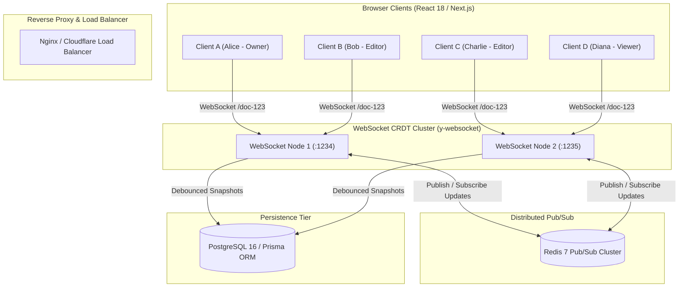
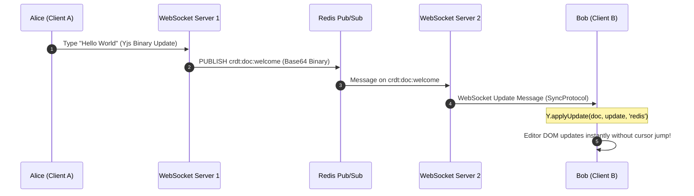

# System Architecture: Real-Time Collaborative Workspace

## 1. High-Level Architecture Overview

The system is designed as a distributed, high-concurrency real-time collaborative workspace supporting rich-text documents (Notion-style) and infinite whiteboards (Figma-style).

---

## 2. How Conflict-Free Replicated Data Types (CRDTs) Resolve Conflicts

### Why Not Operational Transformation (OT)?
Traditional collaborative systems (e.g., legacy Google Docs) utilized Operational Transformation (OT). OT requires a centralized server to transform operations based on a total execution order. If the central server drops or high network partitions occur, transformation matrices become computationally intractable: $O(N^2)$ or $O(N^3)$ complexity.

### Yjs YATA (Yet Another Transformation Approach)
Yjs implements state-based & operation-based CRDT hybrid structures on a doubly-linked list of items:
- **Item Identity**: Every character or block inserted into the document is tagged with an immutable tuple: `(client_id, clock_counter)`.
- **Left and Right References**: When inserting text between characters $L$ and $R$, the new item $I$ records $origin = L$ and $right = R$.
- **Conflict Resolution Rule**:
  If two clients concurrently insert an item between the same $L$ and $R$:
  $$\text{Origin}_A = \text{Origin}_B \quad \text{and} \quad \text{Right}_A = \text{Right}_B$$
  Yjs deterministically orders them by evaluating:
  1. Priority order of previous items.
  2. If tie persists, comparing client IDs: $\text{client}_A < \text{client}_B$.
- **Convergence Guarantee**: Because the comparison is deterministic and associative, every client arrives at the exact same sequence without requiring central coordinator approval or locking.

---

## 3. Real-Time Presence & Awareness Protocol

- **Cursor Tracking**: As users move their mouse or selection, the client sends awareness packets:
  `{ cursor: { x, y }, user: { name: "Bob", color: "#10b981" } }`.
- **Clock Timers & Heartbeats**: If a user closes the tab or loses connection, the server's awareness timeout marks the client ID as expired after 30 seconds and broadcasts a removal event to remaining peers.
- **Figma Pointer Rendering**: The canvas calculates relative offsets `(clientX - bounds.left) / scale` and translates them into smooth SVG cursor overlays with name tags.

---

## 4. Horizontal Scalability via Redis Pub/Sub

When thousands of users edit concurrently:
1. Multiple instances of `server/websocket-server.ts` run behind an Nginx reverse proxy.
2. When an update arrives at `Node 1`, it writes to local clients and broadcasts to Redis channel `crdt:doc:${docId}`.
3. `Node 2` receives the broadcast and applies it to its local `Y.Doc` with origin `'redis'`.
4. The `'redis'` origin prevents echo feedback loops.

---

## 5. Persistence Strategy

- **Debounced Flush**: Rather than writing every keystroke to PostgreSQL, updates are accumulated in memory.
- A 2,000ms debounce timer triggers `Y.encodeStateAsUpdate(ydoc)`.
- The binary update is compressed and saved as base64 in the `yjsState` column of the `Document` table.
- **Point-in-Time Snapshots**: Users can capture explicit named snapshots (e.g. "v1.0 Milestone"), enabling instantaneous one-click rollback.
