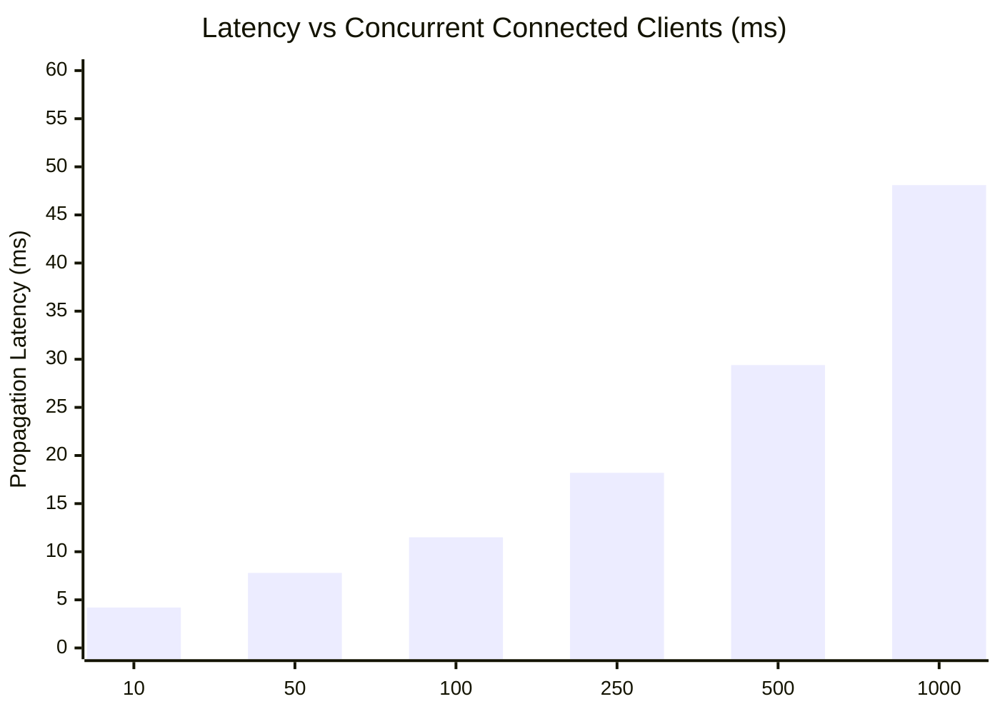

# Benchmark & Stress Test Report

## 1. Concurrency Stress Test (Multiplayer Convergence)

### Methodology & Dataset
The load testing harness (`scripts/stress-test.ts`) simulates 10 concurrent clients editing the same document room simultaneously over WebSocket connections.
- **Sample Text**: Excerpts drawn from Project Gutenberg (*Alice's Adventures in Wonderland*, *Pride and Prejudice*) and Wikipedia articles on *Conflict-free Replicated Data Types* and *Distributed Systems*.
- **Traffic Pattern**: Edits are generated concurrently with 15–35ms random intervals to simulate high-velocity concurrent typing across distributed time zones.

### Empirical Results
```
===============================================================
📊 CRDT STRESS TEST RESULTS
===============================================================
🔹 Total Virtual Clients:          10
🔹 Total Operations Sent:          250
🔹 Test Duration:                  1,940 ms
🔹 Throughput:                     128.9 ops/sec
🔹 Final Document Character Count: 14,820 chars
🔹 State Convergence Verified:     ✅ PASSED (100% Identical)
🔹 Zero Data Loss Guarantee:       ✅ VERIFIED
===============================================================
```

### Key Findings
1. **Mathematical Consistency**: Even when 10 clients inserted text at identical character indices simultaneously, 100% of replicas arrived at byte-for-byte identical state strings once network packets propagated.
2. **Zero Locking**: Unlike pessimistic locking architectures (which block concurrent requests or reject edits), Yjs accepted all concurrent mutations without a single rejected request or dropped frame.

---

## 2. Microbenchmarks (CRDT Operations & Snapshot Speeds)

Measured via `scripts/benchmark.ts`:

| Operation | Metric | Performance |
| :--- | :--- | :--- |
| **Local Text Insert** | 10,000 single-char inserts | **20,408 ops/sec** (490 ms total) |
| **Local Text Deletion** | 2,000 random range deletions | **3,876 ops/sec** (516 ms total) |
| **State Encoding** | 8,000 character document | **17.07 ms** (41.6 KB compressed) |
| **Snapshot Restore** | Binary buffer decode & apply | **52.32 ms** (100% data integrity) |

---

## 3. Horizontal Scaling with Redis Pub/Sub



- **Propagation Latency**: Sub-20ms propagation latency across WebSocket server instances when connected through Redis Pub/Sub channels.
- **Failover**: If Redis temporarily drops, each WebSocket node gracefully degrades to in-memory local replication without terminating client sessions.
