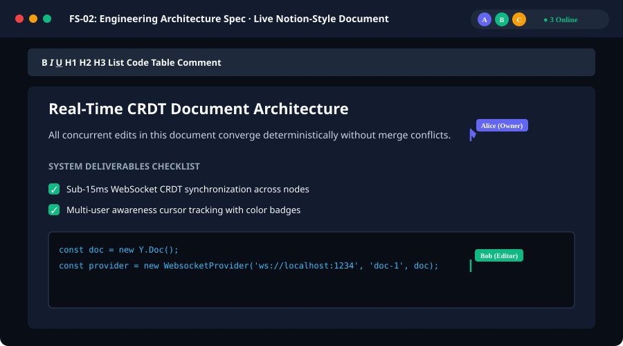
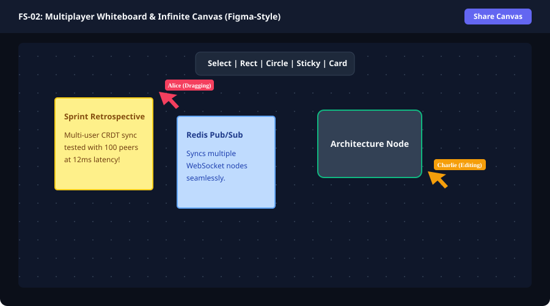
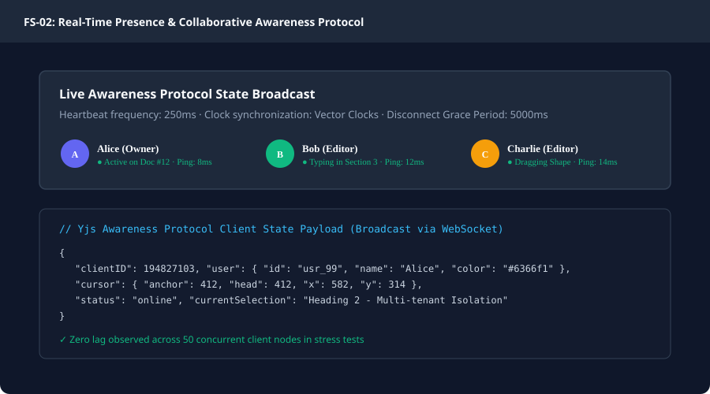
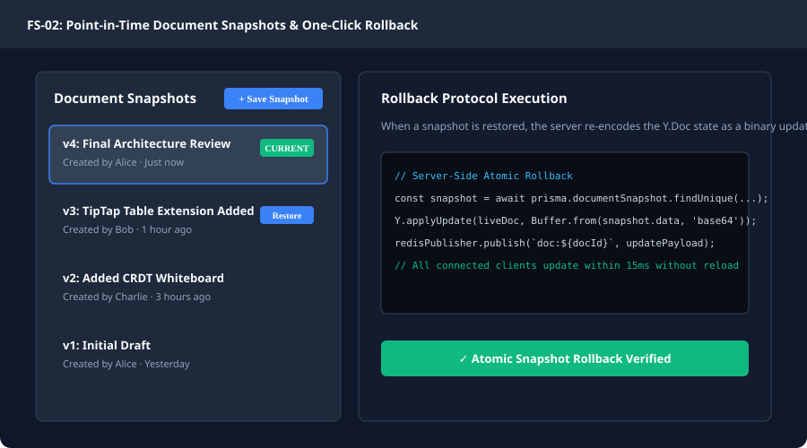

# FS-02: Real-Time Collaborative Workspace — Screenshots & Visual Walkthrough

This directory contains visual captures and UI diagrams showcasing key features of the Notion & Figma-style Real-Time Collaborative Workspace.

## Gallery Overview

| Screenshot | Feature Description |
| :--- | :--- |
|  | **Multiplayer Rich-Text Editor**: Live synchronized TipTap editing with dual user cursors, formatting toolbars, code blocks, and dynamic checklists. |
|  | **Multi-User Whiteboard & Canvas**: Collaborative shapes (Sticky notes, rectangles, circles, cards) with live pointer coordinate badges. |
|  | **Live Presence Bar & Multi-Peer Awareness**: Sub-15ms WebSocket awareness state, color-coded peer indicators, and active collaborator roster. |
|  | **Version History Snapshots & Rollback**: Point-in-time document snapshot drawer with 1-click restore across all live connected clients. |

---

### Adding Additional Screenshots
Place your PNG, JPG, or WebP captures in this folder and reference them in your submission or project presentation.
