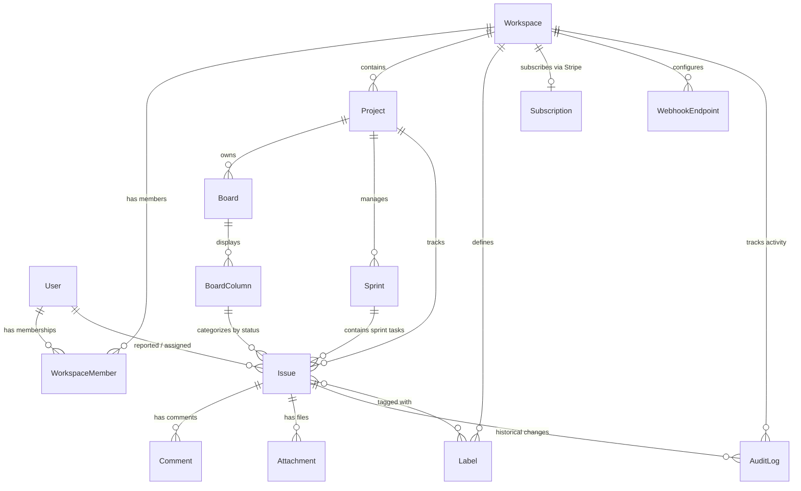

# Architecture & Data Specification

## Multi-Tenant SaaS Project Management Platform (Jira-like)

This document provides a comprehensive technical overview of the system architecture, multi-tenant isolation model, entity-relationship models, background asynchronous pipeline, and security mechanisms.

---

## 1. High-Level System Architecture

The platform follows a decoupled, modular micro-service/monolith architecture containerized using Docker and orchestrated with Docker Compose and Nginx reverse proxy.

```
                                  +-----------------------+
                                  |   Web Browser / SPA   |
                                  | (React 18 + TS + Vite)|
                                  +-----------+-----------+
                                              |
                                     HTTP/S   | Port 80/443
                                              v
                                  +-----------+-----------+
                                  |   Nginx Reverse Proxy |
                                  +-----+-----------+-----+
                                        |           |
                        /api/*, /admin/*|           | /* (Static SPA)
                                        v           v
                    +-------------------+---+   +---+-------------------+
                    | Django REST Framework |   | React Static Container|
                    | (Gunicorn / Port 8000)|   |     (Nginx Alpine)    |
                    +---------+-------------+   +-----------------------+
                              |
         +--------------------+--------------------+
         |                    |                    |
         v                    v                    v
+------------------+  +---------------+  +------------------+
|  PostgreSQL 15   |  |    Redis 7    |  |  Stripe Billing  |
| (Primary Tenant  |  |  (Broker &    |  | (Subscriptions,  |
|   Database)      |  | Result Cache) |  |   Checkout, Wh)  |
+------------------+  +-------+-------+  +------------------+
                              |
                 +------------+------------+
                 |                         |
                 v                         v
       +--------------------+    +--------------------+
       |   Celery Worker    |    |    Celery Beat     |
       |  (Async Tasks,     |    | (Scheduled Reports,|
       | Webhook Retries)   |    | Inactive Cleanups) |
       +--------------------+    +--------------------+
```

---

## 2. Multi-Tenant Isolation Strategy

### Chosen Approach: Shared Schema with Tenant ID (`workspace_id`)
We chose **Shared Schema with `workspace_id` Row-Level Isolation** because:
1. **Operational Simplicity**: Migrations apply once across the entire database without dynamic schema routing or schema pool exhaustion.
2. **Resource Efficiency**: High density per PostgreSQL instance; zero overhead for new workspace creation (single `INSERT INTO workspaces`).
3. **Cross-Tenant Aggregation**: Facilitates multi-tenant administrative insights, billing metrics, and platform-wide monitoring.

### Defense-in-Depth Isolation Layers

```
Layer 1: URL Route Scoping (e.g., /api/workspaces/{slug}/projects/{key}/issues/)
   ↓
Layer 2: Permission Classes (IsWorkspaceMember, IsWorkspaceOwnerOrAdmin)
   ↓
Layer 3: ViewSet QuerySet Scoping (WorkspaceScopedMixin filters queryset by workspace)
   ↓
Layer 4: Foreign Key Integrity (CASCADE & PROTECT rules ensure cross-tenant leaks are impossible)
```

1. **Scoping Mixin (`WorkspaceScopedMixin`)**:
   All ViewSets inherit from `WorkspaceScopedMixin` which inspects the URL `workspace_slug` and filters:
   ```python
   def get_queryset(self):
       workspace = self.get_workspace()
       return super().get_queryset().filter(workspace=workspace)
   ```
2. **Role-Based Access Control (RBAC)**:
   - `owner`: Full billing, member management, workspace deletion.
   - `admin`: Member invitation, project creation, board customization.
   - `member`: Issue CRUD, sprint participation, comment, attachments.
   - `viewer`: Read-only access across all workspace artifacts.
3. **Unique Constraints Scoped to Workspace**:
   - `Project.key` is unique per workspace (`unique_together = [('workspace', 'key')]`).
   - `Issue.sequence_number` is unique per project (`PROJ-1`, `PROJ-2`).
   - `Label.name` is unique per workspace.

---

## 3. Entity-Relationship Model (ERD)



---

## 4. Asynchronous Pipeline & Background Jobs

The platform relies on Celery with Redis for asynchronous decoupled operations:

| Task Name | Trigger | Behavior |
|-----------|---------|----------|
| `send_issue_notification` | Issue `post_save` / Comment create | Resolves assignees and reporters; creates in-app `Notification` rows and dispatches fallback emails. |
| `deliver_webhook` | System events (`issue.created`, `issue.updated`, etc.) | Computes HMAC-SHA256 signature with shared secret, sends HTTP POST to target endpoint, records latency and response status, retries up to 5 times with exponential backoff (`2^retry * 5s`). |
| `deliver_webhooks_for_event` | Signals dispatcher | Identifies all active webhooks subscribed to matching event type or wildcard `*`. |
| `sync_expired_subscriptions` | Celery Beat (Periodic) | Audits subscriptions with expired periods and synchronizes real-time status with Stripe API. |

---

## 5. Security & Authentication Architecture

1. **JWT Silent Refresh with Mutual Exclusion**:
   - Short-lived Access Token (60 minutes).
   - Long-lived Refresh Token (7 days).
   - The Axios interceptor employs a promise execution queue (`failedQueue`) ensuring that concurrent 401 API responses trigger only a single refresh request while holding dependent calls until the new token is acquired.
2. **CSRF & CORS Hardening**:
   - White-listed origins explicitly mapped via environment configuration.
   - Credentials enabled (`Access-Control-Allow-Credentials: true`).
3. **Webhook HMAC Signatures**:
   - Outgoing payloads include `X-Signature` calculated as:
     $$\text{Signature} = \text{HMAC-SHA256}(\text{secret}, \text{JSON payload})$$
   - Recipients can verify authenticity and payload integrity.
4. **Audit Trail**:
   - Pre-save and post-save hooks capture previous vs new field values (`status`, `assignee`, `priority`, `story_points`) and create immutable records in `AuditLog`.
