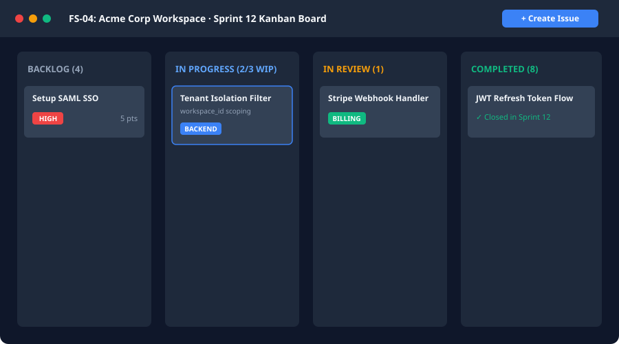
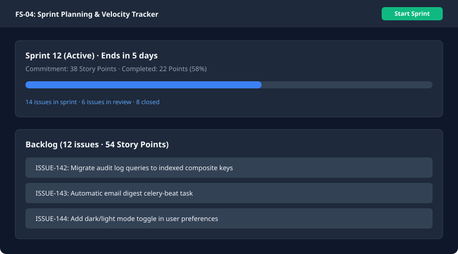
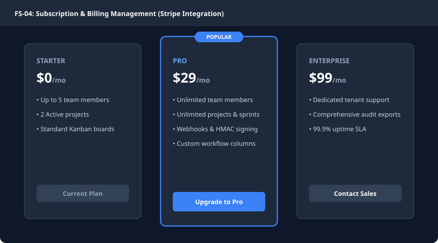
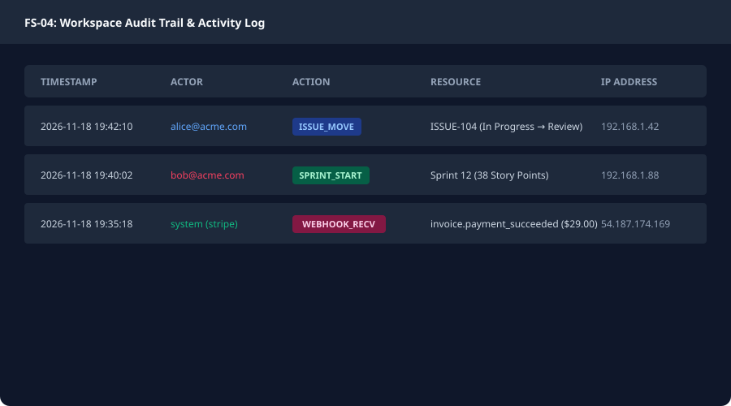

# FS-04: Multi-Tenant SaaS Platform — Screenshots & UI Walkthrough

This directory contains visual captures and UI diagrams showcasing key features of the Multi-Tenant SaaS Project Management Platform.

## Gallery Overview

| Screenshot | Feature Description |
| :--- | :--- |
|  | **Interactive Kanban Board**: Drag-and-drop task movement with WIP column limits, assignee avatars, issue tags, and inline task creation. |
|  | **Sprint Planning & Backlog**: Sprint lifecycle management (Start, Complete, Velocity metrics), story point calculation, and backlog backlog reordering. |
|  | **Subscription & Tier Billing**: Free, Starter, and Enterprise tier management integrated with Stripe Checkout and Customer Portal. |
|  | **Audit Trail & Activity Stream**: Real-time audit logs capturing all workspace actions, timestamps, actor IDs, and IP metadata. |

---

### Adding Additional Screenshots
Place your PNG, JPG, or WebP captures in this folder and reference them in your submission or project presentation.
