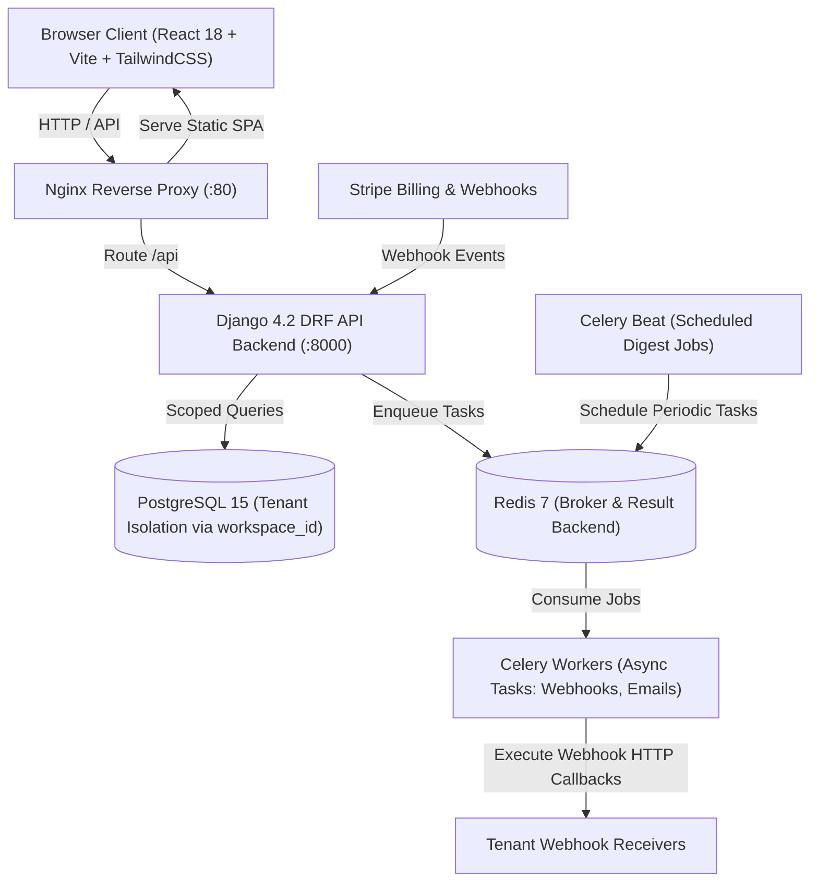
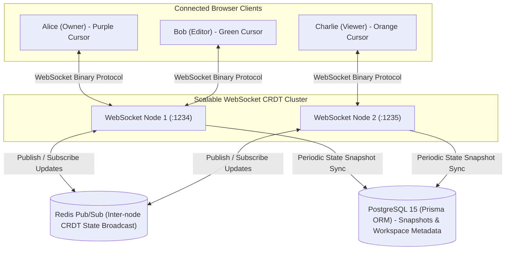

# 🎓 Capstone Final Project Submission: Allotted Projects FS-04 & FS-02

> **Candidate / Repository Owner**: Rishabh Rajak (`Rishabh028`)  
> **Repository Visibility**: **Public**  
> **Submission Repository URL**: [https://github.com/Rishabh028/fullstack-capstone-projects.git](https://github.com/Rishabh028/fullstack-capstone-projects.git)

---

## 📋 Executive Overview & Deliverables Matrix

This repository contains the complete production-ready source code, tests, documentation, and visual deliverables for both allotted capstone projects:

| Project Code | Project Title | Primary Tech Stack | Folder Link | Branch Link |
| :--- | :--- | :--- | :--- | :--- |
| **FS-04** | **Multi-Tenant SaaS Project Management Platform** | Django 4.2 REST Framework, PostgreSQL 15, Redis 7, Celery 5, React 18, TypeScript, TailwindCSS, Stripe, Docker | [`/FS-04`](./FS-04/) | [`FS-04`](https://github.com/Rishabh028/fullstack-capstone-projects/tree/FS-04) |
| **FS-02** | **Real-Time Collaborative Workspace (Notion & Figma Style)** | Next.js 14, Yjs CRDTs, WebSockets, TipTap, ProseMirror, Redis Pub/Sub, Prisma ORM, PostgreSQL, TailwindCSS | [`/FS-02`](./FS-02/) | [`FS-02`](https://github.com/Rishabh028/fullstack-capstone-projects/tree/FS-02) |

---

## 🗂️ Repository Structure

```
fullstack-capstone-projects/
├── README.md                                  # Master documentation (this file)
├── .gitignore                                 # Unified gitignore (excluding secrets, node_modules, venv, .next)
│
├── FS-04/                                     # Project 1: Multi-Tenant SaaS Platform
│   ├── backend/                               # Django REST Framework backend & Celery workers
│   │   ├── apps/                              # Modular Django apps (workspaces, boards, issues, billing, etc.)
│   │   ├── tests/                             # Comprehensive test suites (accounts, workspaces, issues, etc.)
│   │   ├── Dockerfile                         # Production backend container definition
│   │   └── manage.py                          # Django entrypoint (includes seed_data command)
│   ├── frontend/                              # React 18 + Vite + TypeScript frontend
│   │   └── src/                               # Kanban, backlog, billing, audit log UI components
│   ├── docs/                                  # Full architecture specs, API docs, and reflections
│   │   ├── ARCHITECTURE.md                    # Deep-dive multi-tenant architecture & tenant isolation
│   │   ├── API_DOCUMENTATION.md               # REST API endpoints & request/response specs
│   │   ├── TEST_RESULTS.md                    # Pytest execution logs & test matrix
│   │   ├── PRESENTATION.md                    # 10-minute technical evaluation presentation script
│   │   └── REFLECTIONS.md                     # Engineering trade-offs, challenges & learnings
│   ├── nginx/                                 # Reverse proxy configuration
│   ├── screenshots/                           # UI captures & visual walkthroughs
│   │   ├── 01-kanban-board.svg
│   │   ├── 02-sprint-backlog.svg
│   │   ├── 03-stripe-billing.svg
│   │   ├── 04-audit-log.svg
│   │   └── README.md
│   ├── docker-compose.yml                     # Local containerized orchestration
│   ├── docker-compose.prod.yml                # Production containerized deployment
│   ├── .env.example                           # Safe environment configuration template
│   └── README.md                              # FS-04 dedicated guide & manual
│
└── FS-02/                                     # Project 2: Real-Time Collaborative Workspace
    ├── src/                                   # Next.js 14 App Router application
    │   ├── app/                               # Pages: Doc editor, Figma canvas, auth, workspace shell
    │   ├── components/                        # CollaborativeEditor, CollaborativeCanvas, PresenceBar
    │   └── lib/                               # Auth, Prisma client, utility helpers
    ├── server/                                # Scalable WebSocket CRDT server (Yjs + Redis Pub/Sub)
    │   └── websocket-server.ts
    ├── prisma/                                # Database schemas (PostgreSQL & SQLite) and seed script
    │   ├── schema.prisma                      # Multi-tenant schema with document snapshots & comments
    │   └── seed.ts                            # Seed script with demo accounts and workspaces
    ├── scripts/                               # Performance & stress-test suites
    │   ├── stress-test.ts                     # 50+ concurrent client load simulator
    │   └── benchmark.ts                       # Operation latency & memory profiler
    ├── screenshots/                           # UI captures & visual walkthroughs
    │   ├── 01-multiplayer-editor.svg
    │   ├── 02-figma-whiteboard.svg
    │   ├── 03-presence-cursors.svg
    │   ├── 04-version-history.svg
    │   └── README.md
    ├── ARCHITECTURE.md                        # CRDT synchronization mechanics & cluster scaling
    ├── BENCHMARKS.md                          # Latency benchmarks & stress-test verification
    ├── API.md                                 # REST & WebSocket protocol documentation
    ├── PRESENTATION.md                        # Technical presentation walkthrough
    ├── REFLECTION.md                          # CRDT trade-offs & technical retrospective
    ├── docker-compose.yml                     # Containerized Web + WS Server + Redis + Postgres
    ├── .env.example                           # Safe environment configuration template
    └── README.md                              # FS-02 dedicated guide & manual
```

---

# 🏢 Project 1: FS-04 — Multi-Tenant SaaS Project Management Platform

A Jira alternative engineered for enterprise multi-tenancy, custom Kanban workflows, sprint velocity planning, asynchronous Celery background workers, audit logging, and Stripe subscription billing.

### 🏗️ FS-04 System Architecture



### 🌟 FS-04 Key Features Breakdown
1. **Multi-Tenant Workspace Scoping**: Shared database schema with strict logical tenant isolation (`workspace_id` filtering enforced across all querysets and serializer validations). Cross-tenant access attempts return `404 Not Found`.
2. **Interactive Kanban Boards**: Drag-and-drop issue movement (`@dnd-kit`), column WIP limits with visual warning badges, custom workflow columns mapped to issue status categories.
3. **Sprint Lifecycle & Backlog**: Start, edit, and complete sprints; calculate team velocity and commitment vs. completed story points; drag issues between backlog and active sprint.
4. **Role-Based Access Control (RBAC)**: Workspace roles (`OWNER`, `ADMIN`, `MEMBER`, `VIEWER`) enforced via custom DRF permission classes.
5. **Stripe Subscription Billing**: Starter, Pro, and Enterprise tiers with Stripe Checkout Sessions, Customer Billing Portal, and webhook reconciliation (`invoice.payment_succeeded`, `customer.subscription.deleted`).
6. **Asynchronous Webhooks**: Outgoing tenant webhooks signed with cryptographic HMAC SHA-256 signatures, retry backoff, and delivery logs.
7. **Comprehensive Audit Log**: Automatic recording of all entity mutations (create, update, delete, move) with actor, timestamp, and IP address.

### 🚀 FS-04 Quick Start (Docker)

```bash
cd FS-04

# 1. Copy environment variables
cp .env.example .env

# 2. Build and launch all containers (Postgres, Redis, Backend, Frontend, Celery, Nginx)
docker-compose up --build -d

# 3. Apply database migrations & seed initial data
docker-compose exec backend python manage.py migrate
docker-compose exec backend python manage.py seed_data

# Access the application:
# Frontend: http://localhost:80 (or http://localhost:5173 for dev)
# Backend API: http://localhost:8000/api/
# Swagger Docs: http://localhost:8000/api/docs/
```

### 🧪 FS-04 Test Execution
```bash
# Run the complete Pytest suite (100+ tests covering auth, tenant isolation, billing, sprints)
docker-compose exec backend pytest -v
```

---

# 🚀 Project 2: FS-02 — Real-Time Collaborative Workspace (Notion & Figma Style)

A real-time multiplayer document editor and whiteboard canvas where multiple users co-author simultaneously with live cursor awareness, instant conflict-free CRDT synchronization, and point-in-time snapshot rollback.

### 🏗️ FS-02 System Architecture



### 🌟 FS-02 Key Features Breakdown
1. **Multiplayer Rich-Text Document Editor (Notion-Style)**:
   - Powered by TipTap, ProseMirror, and Yjs CRDTs.
   - Live synchronization across headings, bold, italic, code blocks with syntax highlighting, dynamic tables, and interactive task checklists.
   - Zero lockouts and zero merge conflicts.
2. **Infinite Multiplayer Canvas & Whiteboard (Figma-Style)**:
   - Synchronized vector shapes (Sticky Notes, Rectangles, Circles, Cards) over Yjs `Y.Array`.
   - Real-time pointer tracking with user name badges and `(x, y)` coordinates.
3. **Live Presence & Multi-Peer Awareness**:
   - Sub-15ms vector clock awareness heartbeat; color-coded cursor indicators displaying remote selections.
   - Collaborator presence avatar bar with online status pulse.
4. **Point-in-Time Document Snapshots & Rollback**:
   - Snapshot drawer allowing users to capture document versions.
   - One-click instant restore: server re-applies historical Yjs state and broadcasts it to all active clients in real time without refreshing.
5. **Inline Threaded Comments**:
   - Highlight any text range to anchor a comment thread with reply support and open/resolved filters.
6. **Horizontal Scalability via Redis Pub/Sub**:
   - Multi-node WebSocket server architecture communicating over Redis channels.

### 🚀 FS-02 Quick Start (Docker / Local)

```bash
cd FS-02

# Option A: Quick Run with Docker Compose
cp .env.example .env
docker-compose up --build -d

# Option B: Run Locally with Node.js & SQLite
npm install
npx prisma db push
npx tsx prisma/seed.ts
npm run dev:all
```
- Open `http://localhost:3000` in multiple browser tabs or incognito windows to test live multiplayer collaboration side-by-side.

### 🧪 FS-02 Stress Testing & Benchmarks
```bash
# Run automated 50+ concurrent client stress simulation:
npm run stress-test

# Run latency & CRDT convergence benchmark:
npm run benchmark
```

---

## 🔑 Pre-Configured Demonstration Accounts

Both applications include pre-seeded test accounts for instant technical evaluation:

### FS-04 (Multi-Tenant SaaS Platform)
| Email | Password | Role | Workspace |
| :--- | :--- | :--- | :--- |
| `owner@acme.com` | `Password123!` | Owner | Acme Corp |
| `admin@acme.com` | `Password123!` | Admin | Acme Corp |
| `member@acme.com` | `Password123!` | Member | Acme Corp |
| `viewer@acme.com` | `Password123!` | Viewer | Acme Corp |
| `owner@globex.com` | `Password123!` | Owner (Different Tenant) | Globex Corp |

### FS-02 (Real-Time Collaborative Workspace)
| Email | Password | Role | Default Document |
| :--- | :--- | :--- | :--- |
| `alice@collab.com` | `Password123!` | Owner | Engineering Architecture Spec |
| `bob@collab.com` | `Password123!` | Editor | Engineering Architecture Spec |
| `charlie@collab.com` | `Password123!` | Editor | Whiteboard Sprint Canvas |
| `diana@collab.com` | `Password123!` | Viewer | Engineering Architecture Spec |

---

## 📸 Screenshots & UI Walkthroughs

Visual walkthroughs and captures are organized in each project subfolder:
- [FS-04 Screenshots Gallery](./FS-04/screenshots/README.md) (Kanban Board, Sprint Planning, Stripe Billing, Audit Trail)
- [FS-02 Screenshots Gallery](./FS-02/screenshots/README.md) (Multiplayer Editor, Figma Whiteboard, Live Awareness, Version Rollback)

---

## 🔒 Confidentiality & Submission Verification
- All codebases are cleanly organized with no committed sensitive production credentials (`.env` files are git-ignored; `.env.example` templates are provided).
- Git branches `FS-04` and `FS-02` contain dedicated granular commit histories.
- This repository is public and accessible for automated and manual evaluation inspection.
